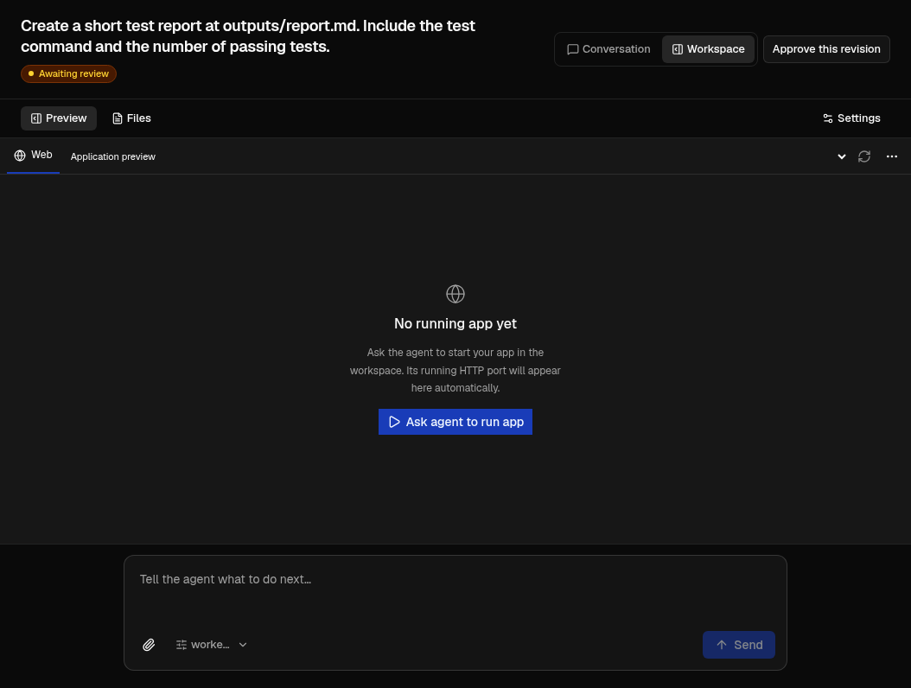

+++
title = "Preview a website or desktop app"
+++

Open a finished or running task in your project’s **Workspace**, then select **Workspace** at the top of the thread. Use **Preview** to inspect the app alongside the conversation.

## Open a website

1. In **Preview**, select **Web**.
2. If Harbormaster finds a running website inside the worker, select **Open detected app**.
3. If no server is running, select **Ask agent to run app**. Review the prepared message and select **Send**. Return to **Web** when the app is ready.
4. To show the agent a change you want, select **Markup**, mark the area, and describe the change in the message draft. Send the message when you are ready.

If your team gave you a start command, open **Preview options** and select **Preview settings**. Enter the worker-relative directory, the command, and the port, then select **Start preview**.

## Open a desktop app

1. Create a thread with the **Desktop App Development** work profile and a worker that supports desktop sessions.
2. In the thread’s **Workspace**, open **Preview**, then **Desktop**.
3. Select **Start worker desktop** if prompted. Ask the agent to launch the app or open it in the worker session.

## Recover or close a preview

Open **Preview options**, then **Application logs**, to see what the web app printed when it started. If you need help, use **Ask agent to debug**, check the prepared message, and send it.

To end a web app started in Harbormaster, select **Stop app** in **Preview settings**. Use **Disconnect preview** to close the forwarding for an app started outside preview management. If the worker restarts, start the app and reopen the preview.

See [review a result](reviews.md) to approve a revision or send more feedback.
