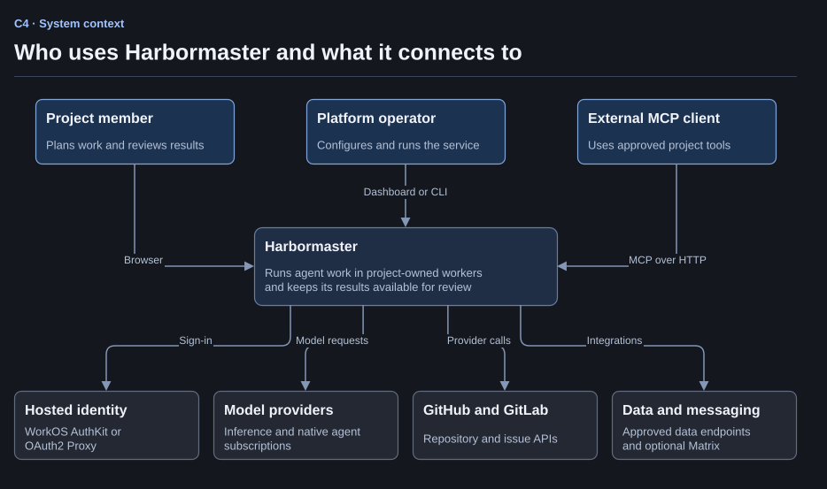

+++
title = "Harbormaster architecture"
linkTitle = "Architecture"
description = "System context, service topology, deployment boundaries, and platform constraints for solution architects."
+++

Harbormaster coordinates software and research work across projects. The control plane authorizes requests and tracks work. Project-owned workers run agents and keep their private files. Compute can stop or be replaced while a worker’s identity and storage persist.

## System context

Project members plan work and review results in the dashboard. Operators configure the service, credentials, and runtimes. External agents can use scoped tools through the Model Context Protocol (MCP).

Hosted deployments can use WorkOS AuthKit or an identity-aware proxy. Model and source control integrations depend on deployment policy. Matrix is an optional Hermes integration. [Hosted identity](../authkit.md) · [Repository providers](../repository-connections.md) · [Hermes setup](../operations/hermes.md)

## Service topology

The C4 container view shows the applications and stores that make up Harbormaster. Green boxes mark persistent stores, purple boxes mark worker compute, and dashed outlines group related services or show deployment boundaries. Dashed connectors show where policy services use configured secrets. The CLI runs on the operator’s machine. [C4 diagram types](https://c4model.com/diagrams)

| Service | Responsibility |
| --- | --- |
| Dashboard | Serves the React UI, handles browser authentication, and proxies allowed project and interactive worker routes. |
| Project MCP | Exposes a bounded set of project operations to authenticated clients. |
| Control plane | Owns project authorization, metadata, quota, work attempts, and scheduled dispatch. |
| Runtime controller | Applies runtime policy, manages worker generations, and forwards allowed requests to each worker. |
| Worker | Runs the supervisor and agent processes. Keeps files, task results, and native state in private storage. |
| Inference gateway | Mediates model requests and configured subscription credentials. |
| Credential broker | Runs named operations against configured services using scoped credentials. |
| Egress gateway | Checks exact destinations for restricted outbound traffic. |

The diagram shows platform roles. Transports and the components present vary by backend. Firecracker uses host-side brokers and fixed guest channels. See [deployment topology](deployment-model.md) and [security boundaries](security.md).

## Identity and content boundaries

| Boundary | What belongs there |
| --- | --- |
| Project | Membership, worker ownership, work items, approved integrations, and exchange grants. |
| Platform PostgreSQL | Project configuration, lifecycle and task metadata, references, and a [private recorded history cache](../workspace-history.md). |
| Worker storage | Files, native agent state, task instructions and results, analysis datasets, and published artifacts. |
| Vault or configured secret files | Scoped upstream credentials and certificate keys used by trusted services. |

Project-access checks apply before worker dispatch. The dashboard’s operational snapshot has its own credential and field allowlist. Same-project [file handoffs](contracts.md#dashboard) are explicit copies. Cross-project [assistant exchanges](assistant-exchanges.md) use approved operation grants and selected export bodies.

## Coordination and recovery

The control plane runs as a single replica. Per-worker locks coordinate lifecycle operations, and quota is reserved before startup. Scheduled delivery retries with a stable task key. The worker marks interrupted runs as failed after restart and retains their acceptance records. See [request flows and recovery](request-flows.md).

## Backend support

| Backend | Intended use | Isolation decision |
| --- | --- | --- |
| Docker | Local development and synthetic workloads | Restricted egress modes exist. Verified isolation startup is refused. |
| Kubernetes Agent Sandbox with Kata | Reference deployment | Requires working Kata, CNI policy, project namespace controls, and retained storage. Verified-isolation startup remains gated on live acceptance. |
| Firecracker | Experimental, dedicated KVM host | Jailed microVM with fixed host channels and no guest NIC. Requires pinned artifacts and host acceptance. |

See [deployment topology and tradeoffs](deployment-model.md) before choosing a runtime.

## Dependency direction

The control plane calls the runtime through a provider-neutral protocol. The runtime controller owns backend-specific enforcement. [Code map and dependency rules](../development/code-map.md)

## Next views

- [Control plane and worker components](components.md)
- [Deployment topology](deployment-model.md)
- [Request flows and recovery](request-flows.md)
- [Security boundaries](security.md)
- [Service contracts](contracts.md)
