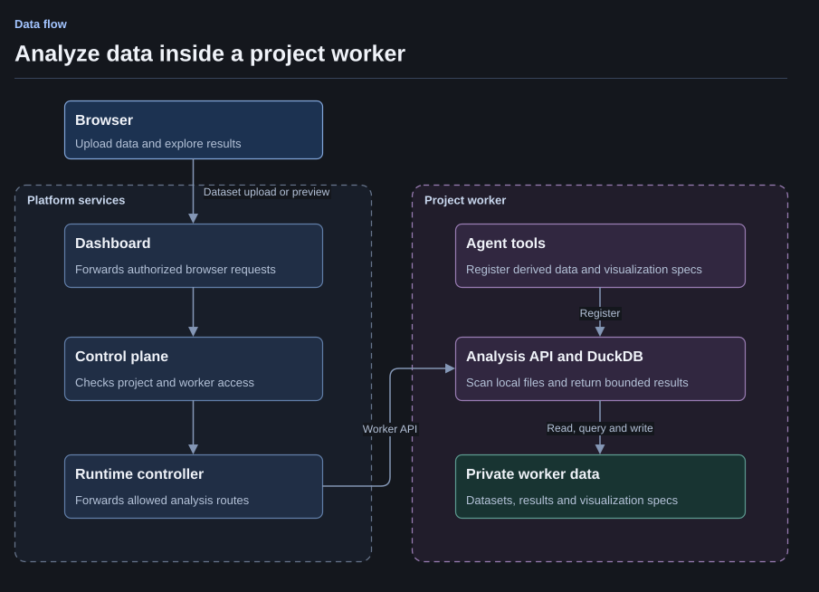

+++
title = "Worker analysis API"
+++

The authenticated control-plane prefix is `/v1/workspaces/{id}/analysis`. The dashboard uses `/ui-api/workspaces/{id}/analysis`. Access checks run before dispatch to the worker. Upload, preview, and spec routes use the existing controller grant. Result and artifact registration are local agent operations.

CSV and Parquet bytes travel to the selected worker during upload. DuckDB queries the stored data there and returns bounded rows or points for the browser to render. Agent tools register derived data and visualization specs inside the same worker.

## Routes

| Method | Path | Body |
| --- | --- | --- |
| GET | `/datasets` | |
| POST | `/datasets/upload?name=sensors.parquet` | File bytes as `application/octet-stream` |
| GET | `/datasets/{dataset}/schema` | |
| POST | `/datasets/{dataset}/preview` | Preview request |
| GET | `/artifacts` | |
| GET | `/artifacts/{artifact}` | |
| POST | `/artifacts/{artifact}/data` | Table page controls or an empty object for a chart or geo artifact |
| POST | `/artifacts/{artifact}/delete` | Empty object |

Browser POSTs require the existing `X-Workbench-Request: 1` header. Include the current `project_id` when calling the dashboard API. Artifact and dataset IDs are resolved only in the authorized worker.

Use `GET /v1/projects/{id}/analysis/visualization-details` to list the current user's title and description edits. Send a POST to the same path with `worker_id`, `artifact_id`, and the fields to change. Send an empty description to clear it.

## Preview requests

A preview request accepts `limit`, `cursor`, `columns`, `sort`, and `filters`. Sort entries contain `field` and `direction`. Filter entries contain `field`, `op`, and, when required, a scalar `value`. Operators are `eq`, `ne`, `lt`, `lte`, `gt`, `gte`, `contains`, `is_null`, and `is_not_null`. Multiple filters use AND. Use strings for exact integers beyond JavaScript's safe integer range.

The response contains `columns`, `rows`, `next_cursor`, `has_more`, `sampled`, and `truncated`. Pass the returned cursor with the same request to read another page. Changing the filters, sort order, projection, or limit starts a new query. Ordered pages use the source row position as a tie breaker. Later sorted pages can require rescanning the source.

## Limits

A worker accepts one upload and runs one DuckDB query at a time. It queues at most three additional queries within the query deadline. Uploads have a 1 GiB file limit and a 10-minute deadline. Datasets and results have a combined 4 GiB limit and a 128-file limit. Queries have an 8-second deadline and a 1 MiB response cap. Tables return up to 500 rows. Charts return up to 2,000 rows. Geo artifacts return up to 5,000 points. Scatter and geo use a seeded reservoir sample for larger data. Table responses can return fewer rows when the byte cap applies. Queries that exceed the DuckDB memory or spill budget return an error. Dataset metadata uses native DuckDB type names.
