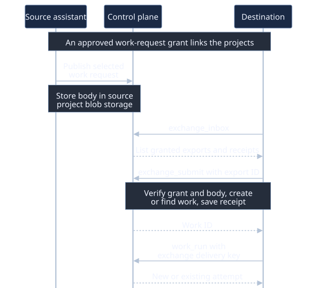

+++
title = "Assistant exchange transport"
+++

## Work request handoff

The control plane keeps the selected export body in the source project's blob storage. The destination consumer uses the export ID to ask the control plane to create work in the destination project. The grant scopes access to that export operation, and destination project rules still govern the selected worker.

## List and read exports

`exchange_inbox(project_id, after?, limit?)` maps to `GET /v1/exchange-inbox`. The limit defaults to 50 and accepts values from 1 to 100. Use the returned `next` cursor until it is empty, then start the next scan with an empty cursor. IDs are stable cursors. Publications that sort before the current cursor appear in the next full scan.

The inbox lists exports with current, approved grants for the destination. The service checks source, operation, and actor provenance. The inbox includes previously consumed receipts with `work_id` so a consumer can recover from a crash after work creation. `exchange_read` checks the grant again and verifies the body digest.

## Submit a work request

`exchange_submit` rechecks the grant and body, then creates work under the destination project. It records a receipt after the work API succeeds. If that write fails, retrying resolves the existing work item through the stable `exchange-{export ID}` key.

The consumer scans every page even if an earlier request fails. It submits granted requests and calls `work_run` with `exchange-{export ID}` as the delivery key. Retries return the original attempt, including for completed work. Historical receipts remain discoverable, so scan cost grows with history.

The Firecracker broker and generation-authenticated MCP endpoint use the [shared project tools manifest](../../../../internal/shared/project-tools.json). An exchange grant authorizes each exchange operation. Human review and grant administration use separate routes. See [configure assistant handoffs](../assistant-handoffs.md) for the setup procedure.
