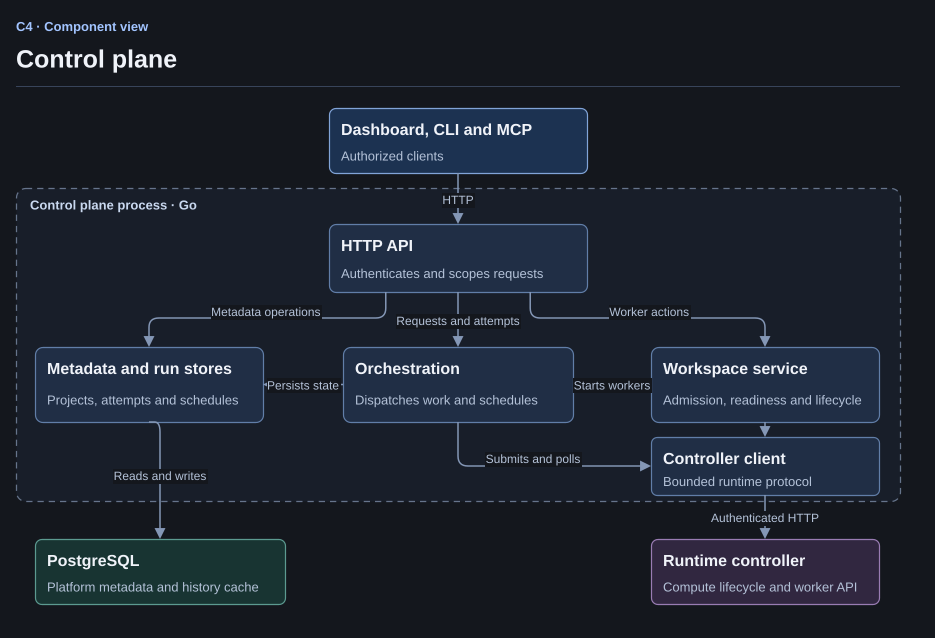
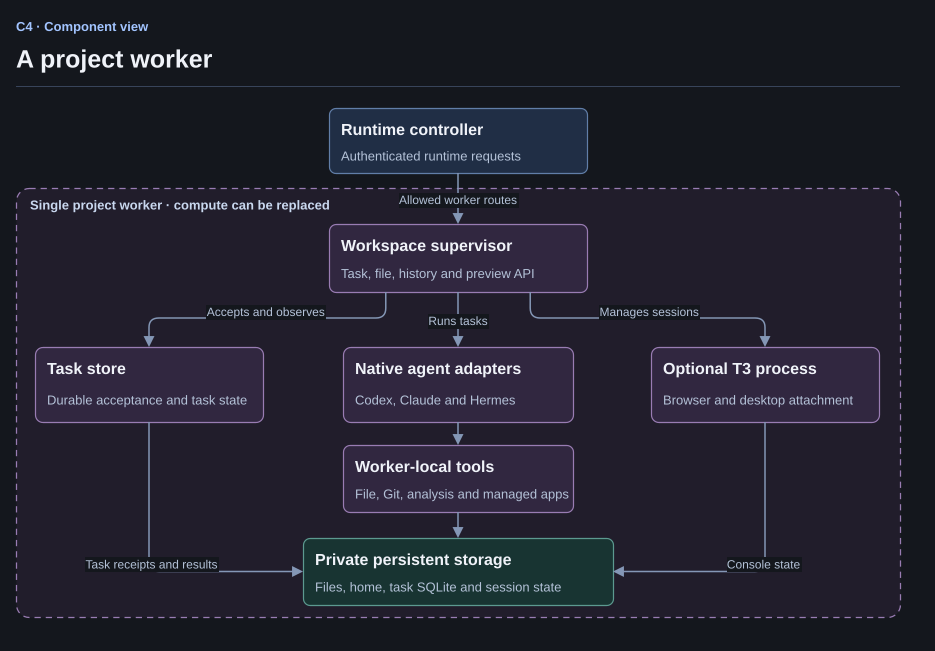

+++
title = "Control plane and worker components"
+++

These C4 component views show where policy decisions run and where agent data is stored. The [service topology](_index.md#service-topology) shows the services these components call.

## Control plane

The HTTP API authenticates the caller and resolves the scope of a request. The workspace service owns admission, quota, readiness, and lifecycle policy. The scheduler and work orchestrator save dispatch state before sending requests to a worker. The runtime client uses a bounded protocol for management and worker API requests.

See [startup readiness](contracts.md#startup-readiness) and [scheduled delivery](contracts.md#scheduled-delivery) for request and retry behavior.

## Worker

Each worker runs a supervisor with task, history, file, analysis, and managed application endpoints. The supervisor uses private SQLite for task acceptance and results. Native Codex, Claude, or Hermes execution takes place inside the worker. Optional T3 access uses a separate session path with workspace-scoped authorization.

Tool calls can read and write the worker’s files. Dataset previews and visualization queries run against worker storage. The control plane records references and serves bounded results through the runtime controller. [Guest execution and artifacts](guest-execution.md) · [Worker analysis API](analysis-api.md)

## Runtime controller

The control plane uses the runtime controller configured for the deployment. The controller creates or resumes compute for the worker, attaches its owned storage, applies provider-specific rules, and exposes a route allowlist for forwarding. It checks grants against active worker generations. Docker, Kubernetes, and Firecracker share the contract and implement enforcement separately. [Runtime contract](contracts.md#workspace-and-runtime-controller)
