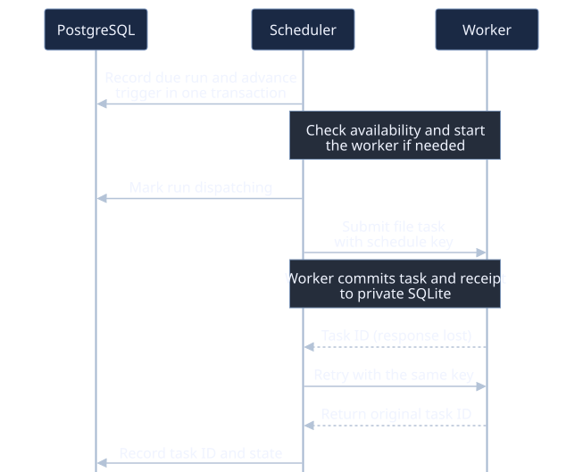

+++
title = "Service contracts"
aliases = ["/docs/contracts/"]
+++

These excerpts describe selected routes. Check the Go implementation and route tests for current authorization and complete fields. JSON uses snake_case. The Go module is `agent-workbench`.

## Control API

The local CLI uses the control token as an Authorization bearer. Project credentials and signed hosted human claims can use the routes allowed by their scope. The control plane exposes a separate authenticated read listener for dashboard snapshots.

| Request | Contract |
| --- | --- |
| `GET /healthz` | Returns public liveness status as `{"status":"ok"}`. |
| `GET /v1/workspaces` | Returns `{"items":[Workspace]}` for the request's scope. |
| `GET /v1/workspaces/{id}` | Returns a workspace with its current observed state when available. |
| `POST /v1/workspaces` | Accepts `project_id`, `idempotency_key`, and optional `name`, `parent_id`, and `branch`. Branching requires an idle source and a new branch name. Returns a workspace with HTTP 201 or HTTP 200 on replay. |
| `POST /v1/workspaces/{id}/start` | Accepts `idempotency_key`. Applies the selected connection profile and waits for readiness within the startup deadline. Returns a workspace. |
| `POST /v1/workspaces/{id}/stop` | Accepts `idempotency_key`. Returns a workspace and keeps its storage. Busy workers and workers with unknown activity reject a normal stop. |
| `POST /v1/workspaces/{id}/tasks` | Accepts `instruction`, `idempotency_key`, and optional `provider`. Starts the worker if needed and returns task metadata. |
| `GET /v1/workspaces/{id}/tasks/{task_id}` | Returns task metadata. |
| `GET /v1/workspaces/{id}/tasks/{task_id}/result` | Takes a byte `offset` and `limit`. Returns `task_id`, `state`, `content`, and `next_offset`. A `next_offset` of `-1` marks the end of the current result. |
| `POST /v1/workspaces/{id}/tasks/{task_id}/cancel` | Accepts `idempotency_key`. Requests cancellation and returns task metadata. |
| `GET /v1/usage` | Returns current quota and allocation totals for the request's scope. |

Task instructions are limited to 64 KiB. Codex and Claude workers accept the corresponding provider choice or use their configured default. Hermes workers run Hermes. Changing the provider on an already accepted task key returns a conflict.

The [Workspace and Task types](../../../../internal/shared/model.go) define the full JSON fields. Nullable resource measurements represent unknown values. `runtime_type` can be `docker`, `kata`, or `firecracker`. Kubernetes can report `WORKSPACE_UNSCHEDULABLE` in `startup_reason` while waiting for capacity. Workers store task instructions and results. The control plane mirrors task metadata and caches recorded history as described in the [history guide](../workspace-history.md).

Errors use `{code,message,retryable}`. Common codes include `INVALID_REQUEST` (400), `UNAUTHORIZED` (401), `NOT_FOUND_OR_FORBIDDEN` (404), `WORKSPACE_BUSY` and `IDEMPOTENCY_CONFLICT` (409), and `QUOTA_EXCEEDED` (429). Unavailable dependencies can return `NOT_READY`, `RUNTIME_UNAVAILABLE`, or `AGENT_PROTOCOL_UNAVAILABLE` (503).

### Startup readiness

`GET /v1/workspaces/{id}/start-readiness` has a five-second deadline and returns `Cache-Control: no-store`. The response contains `workspace_id`, `project_id`, `checked_at`, `can_start`, and `checks`. Every check has `id`, `label`, `status`, and `message`, plus an optional `code`. Status is `passed`, `blocked`, or `unknown`.

The endpoint checks the worker state, runtime capabilities, resources, network policy, branch support, quota, and Hermes setup when applicable. The check creates no reservation or compute. The start request repeats admission under the quota lock. An incompatible capability contract returns `RUNTIME_CAPABILITIES_INCOMPATIBLE` on start.

## Dashboard

The dashboard proxies same-origin `GET /dashboard-api/v1/snapshot` to the control plane read listener on port 8081. Local mode derives a snapshot bearer from the control token. Hosted deployments supply a separate `DASHBOARD_READ_TOKEN` or `DASHBOARD_READ_TOKEN_FILE` to dashboard and control plane. Default host publication is `127.0.0.1:8080`.

The snapshot reports schema version 1, the release version, generation time, and workspace, task, usage, and service observations. Observation groups report `ok`, `partial`, or `unavailable`. Service states are `healthy`, `degraded`, `unavailable`, `unknown`, or `not_configured`. The [snapshot workspace type](../../../../internal/api/snapshot.go) limits which workspace fields the response exposes.

The dashboard app at `/app/` exposes worker controls in the project's **Workers** section. Local mode requires the operator password. Hosted mode uses signed human claims for project operations. Its `/ui-api/` adapter permits profile/workspace listing, creation, start/stop, desktop pairing and bounded file handoffs. Browser mutations require JSON, a custom request header and matching Origin. The dashboard forwards authorized operations to the control plane.

Open T3 mints a one-use, one-minute connection ticket after workspace start. The fragment-only ticket is exchanged on that workspace's own `ws-<id>.localhost` origin for a twelve-hour host-only HttpOnly SameSite cookie. Every native HTTP/WebSocket request validates the workspace-bound cookie. The proxy chain carries native protocol 2 to the managed workspace, replacing each internal hop's authorization. No privileged native browser-session bearer or platform control credential is returned to the browser. See [interactive workspace access](../interactive-workspaces.md).

`POST /ui-api/workspaces/{id}/desktop-pair` accepts a lifecycle idempotency key, starts the workspace, then requests a fresh native T3 pairing credential. Each call mints a fresh credential even when the start key repeats. The response is `{pairing_url,expires_at}` with a fragment-only token and `Cache-Control: no-store`. Links are issued by T3 and expire according to its policy. Native `desktop-ws-<id>.localhost` requests follow a separate authenticated management path to `/v1/t3-desktop/{path...}`. The ingress overwrites `X-Workbench-Native-Authorization` with the original client Authorization header. The supervisor removes that header, restores native client authority, and never injects its browser token. T3 verifies pairing/token exchange, client credentials, DPoP and WebSocket tickets. Only matching HTTP Origins or the exact installed native renderer Origins are accepted. These routes remain loopback-only.

`POST /v1/file-handoffs` (also available through `/ui-api/file-handoffs`) takes `{source_id,source_path,destination_id,destination_path}`. Both workspaces are authorized before observation or content access, must be running/ready/idle, and remain separate volumes. The source file is read through confined `POST /v1/files/read`; the destination uses `POST /v1/files/write-new`. Content is base64-encoded JSON internally, bounded to 1 MiB, and never persisted by platform services. Writes stage a complete file and publish it with an exclusive hard link; existing paths return `DESTINATION_EXISTS`. Paths are project-relative, excluding Git metadata and named credential/configuration paths. A successful handoff returns HTTP 201 `{copied:true,bytes}`. Handoffs do not have exactly-once retry semantics; a lost response requires checking the destination before retrying.

## Workspace and runtime controller

Runtime management endpoints require the controller token. The Docker runtime controller owns Docker API access. Workers use a separate generation-bound bearer credential. The controller forwards requests under `/v1/workspaces/{id}/agent/...` according to the [runtime protocol route policy](../../../../internal/runtime/protocol/protocol.go). The policy includes task, history, file, artifact, and analysis endpoints.

## Gateways

The inference gateway and credential broker are separate services. Each uses port 8080 and exposes `GET /healthz`. The dedicated egress gateway handles HTTP forwarding and CONNECT.

- Inference: `POST /v1/chat/completions`, OpenAI-compatible messages/tools/model, nonstreaming response. Explicit allowlisted origin/model from file. `GATEWAY_MODE=fixture` provides visibly labeled deterministic synthetic inference. `GATEWAY_MODE=upstream` uses fixed configured HTTPS origin (no client URL). Native subscription protocol routes are separate from this endpoint.
- Broker: `POST /v1/operations/{operation}` with validated named parameters; fixture mode returns synthetic data. Upstream fixed origins, operation templates and certificate references in file config. Vault holds certificate/private key; no arbitrary URL/Vault path supplied by client.
- Both authenticate workspace tokens by calling trusted controller `POST /v1/grants/verify` using gateway service credential (`GATEWAY_SERVICE_TOKEN_FILE`). Request `{token,audience}` audience inference or broker. Response `{workspace_id,project_id,principal_id}` on success; fail closed on errors. Controller keeps workspace grants in memory derived from stable secret, binds to current running generation; no access when stopped. Tests may inject a verifier function. Gateways configuration may pass trusted URLs only via env/file, never request fields. Controller URL `http://runtime-controller:8080`.
- Environment: `GATEWAY_MODE`, `GATEWAY_CONFIG` (JSON policy), `CONTROLLER_URL`, `GATEWAY_SERVICE_TOKEN_FILE`; inference upstream credential `INFERENCE_API_KEY_FILE`; broker `VAULT_ADDR`, `VAULT_TOKEN_FILE`. Credential files supplied by operator. No generated fake credentials representing external services.

## MCP

Separate Go binary with official pinned Go SDK, Streamable HTTP `/mcp` and health route. Environment `CONTROLPLANE_URL=http://controlplane:8080`, `PROJECT_SIGNING_KEY_FILE`, `MCP_TOKEN_FILE` (the bootstrap credential for `default`), `MCP_ALLOWED_HOSTS` default localhost,127.0.0.1,mcp. MCP forwards a fixed set of operations and checks the request Host and Origin. It requires authentication in local and hosted deployments. Long-running tools return application task IDs. See the [project MCP guide](../project-workbench.md).

## Native T3 workspace process

Interactive containers run a pinned native T3 server/client bundle beside the Go workspace supervisor. Readiness includes native session creation and a valid protocol-2 shell snapshot. Activity combines native T3 active/background thread state with process observation. Idle T3, resource-monitor, Codex app-server and local MCP protocol processes are recognized individually; arbitrary terminals/commands still block idle-stop. A native T3 failure reports unknown activity and blocks automatic stopping.

Only the stale `userdata/server-runtime.json` process-discovery record is removed at container startup; environment identity, SQLite files and native sessions are retained. Docker branch seeding freezes an idle source, copies up to 256 MiB from `/data/files`, and resumes the source. The target starts after the completion marker is present. The parent's task data and native T3 databases stay on the source.

An idempotent start of an already-ready workspace also reconciles platform network attachments. The authenticated controller `POST /v1/workspaces/{id}/reconcile-network` operation reattaches the deployment-owned controller and gateways. It preserves the running worker and uses trusted network configuration. This restores connectivity after a platform container is recreated.

## Workspace settings

`POST /v1/workspaces/{id}/settings` accepts `idle_timeout_minutes` (0 or an
integer from 5 to 1440) and either `connection_profile_id` or an inline
`connections` policy. Inline policies use mode `blocked`, `allowlist`, or `open`.
Only allowlist mode accepts destinations, up to 64 exact lowercase `host:port`
entries. Changing into or out of open mode on a running workspace returns
`STOP_WORKSPACE_FIRST` before saving. Project
authorization applies before observation or mutation. Zero disables automatic
shutdown; omitted metadata uses the 60-minute deployment default. An explicit
open/start renews `last_opened_at`; polling does not. Transition from BUSY to READY
begins a full idle interval. Unknown activity always blocks shutdown.

The trusted controller accepts `POST /v1/workspaces/{id}/network-policy` with
`{connections:{mode,destinations}}` using its management credential only. Its policy is
bound to the observed container generation and defaults to deny after restart.
An `egress` grant is issued/verified only for an enabled, running generation.
The dedicated egress service accepts HTTP and CONNECT only to destinations in the workspace policy;
DNS resolution and public-address validation happen there. The supervisor exposes
a credential-free loopback proxy to native tools and injects its workspace grant
on the internal hop. It never gives Git a provider/Vault credential. Active
tunnels revalidate authority every five seconds with a five-second verifier
timeout. Destination approval covers the encrypted host, not HTTP paths.

## Global connection profiles

`GET /v1/connection-profiles` returns `{items:[{id,name,description,policy,
revision,updated_at}]}`. The authenticated local operator can create profiles via
`POST /v1/connection-profiles` (revision 0) and edit via
`POST /v1/connection-profiles/{id}` (expected current revision). Stale edits return
`PROFILE_REVISION_CONFLICT`; project credentials cannot mutate global profiles.
`POST /v1/connection-profiles/{id}/delete` removes a profile with an expected
`revision` in the JSON body. A stale or missing profile returns
`PROFILE_REVISION_CONFLICT` (409). Profiles referenced by workspace settings or
Hermes setups return `CONNECTION_PROFILE_IN_USE` (409); select another profile in
those settings first. Deleted built-in profiles are not seeded again on restart.
Names are bounded to 80 bytes, descriptions to 500, policies use existing rules.

Profiles persist in PostgreSQL metadata, seeded once without replacing edits.
Workspace creation/settings accept `connection_profile_id`; workspace metadata
stores `connection_profile_revision` plus an applied `connections` snapshot.
Explicit starts/opens or saving workspace settings resolve the latest version.
Internal access to an already-running workspace retains its snapshot; an actual
cold start resolves current policy. Desired direct-network changes on running
workspaces are refused without overwriting the applied snapshot. Workspace-local
connections detach the global reference. Profile configuration contains no
workspace data, conversation content or credential material.

## Application and runtime compatibility

`POST /v1/projects/{id}/hermes/assistant` accepts `{idempotency_key}` and owns
project assistant selection, creation, connection-profile application and startup.
It returns the started workspace (201 when created, 200 when reused). Multiple
candidate Hermes workspaces return 409 `ASSISTANT_WORKSPACE_AMBIGUOUS`; callers
can choose a workspace explicitly through the normal inventory/lifecycle routes.
The local operator ingress exposes this exact operation under `/ui-api`.

Task status and result polling do not renew `last_opened_at`. For compatibility,
a cold task read can wake stopped compute to access its private task database;
this availability operation does not count as an explicit user-open. An explicit
start/open renews the idle interval. Unknown or unavailable
activity remains conservative and blocks automatic stop.

Runtime `GET /v1/capabilities` returns a flat typed capability object including
`schema_version`, `backend`, `id`, `version`, `agent_kinds`, `network_modes`,
`branch_seed`, `private_homes`, `isolation_status`, `network_status`, and
`resources:{cpu_cores,memory_bytes}`. The internal start specification carries
the reserved resource limits; an incompatible template returns
`RESOURCE_LIMIT_UNAVAILABLE` before allocation. Empty
`network_modes` means no network policy is currently supported, not implicit
permission to bypass policy. The control plane rejects unsupported startup
policies before allocating compute. The Kubernetes adapter checks installed network policy. Verified isolation still requires live deployment acceptance.

Hermes installation status uses the same schema-version-1 capability response.

Controller workspace forwarding validates queries by endpoint. History requests
on `GET /v1/tasks` accept the bounded history selector, paging cursors, ordering,
episode and limit. Task result requests accept nonnegative offset/limit only.
Arbitrary or repeated query fields are rejected consistently by every backend.

See [coordination and recovery](_index.md#coordination-and-recovery) for schema migration, scheduling, and retry behavior.

T3 and native Codex and Claude workers use fixed file and Git MCP servers. The runtime start specification accepts no caller-selected tool list.
Existing workspace/home ownership and legacy private storage paths are retained.

## Schedule management

### Scheduled delivery

Each occurrence has a deterministic run ID. The scheduler sends `schedule:<run ID>` as the acceptance key through the runtime controller. The worker commits its task and receipt before execution. That receipt lets the scheduler recover the original task ID after a lost response. Once the scheduler records the task ID, it polls the task to update the run state.

### Update and delete

The [schedule guide](../project-workbench.md#schedule-work) describes the HTTP and MCP entry points. `POST /v1/schedules/{id}/update` accepts the creation fields,
`revision` (legacy records start at 0), and `idempotency_key`. Project ownership
and the replacement worker are checked. Edits preserve enabled state and history;
changing timing resets the next occurrence. Identical retries do not rewind the
trigger. Stale edits return `SCHEDULE_REVISION_CONFLICT`; edits with unfinished
runs return `SCHEDULE_HAS_UNFINISHED_RUNS` so accepted instructions cannot change.

`POST /v1/schedules/{id}/delete` accepts `revision` and `idempotency_key`. It hides
and disables the schedule and atomically cancels runs not yet dispatched. Accepted
or uncertain dispatches continue under their original identity, including tasks
queued inside a worker. History and schedule metadata remain for observation;
repeated deletion succeeds. Deleted schedules cannot be re-enabled or run manually.
Enable/run-now reject a missing worker with `SCHEDULE_WORKSPACE_UNAVAILABLE`;
disabling, editing to a replacement worker, and deletion remain available. The
same-origin UI proxy permits only the exact POST update/delete routes.

## Work conversations

`POST /v1/board/{id}/start` accepts `project_id`, `revision`, an existing
`workspace_id`, and optional agent `selection`. Supply `workspace_id` when the
task has no assigned worker.

`GET /v1/work-items/{id}/instruction?project_id=...` reads the private saved
specification from a ready worker and verifies its digest. If the worker is unavailable, it can return a cached user message from the latest attempt. Without a cached message, it returns `HISTORY_WORKSPACE_STOPPED`. The response uses `Cache-Control: private, no-store`. The request does not start a worker.

`POST /v1/work-items/{id}/continue` accepts `{project_id,instruction,
expected_attempt_id,idempotency_key}`, plus optional `workspace_id`, `selection`, `screenshots`, and `presentation`. A nonempty UTF-8 instruction is limited to
16,000 bytes. A draft conversation with an assigned worker uses this route for its first message. Later messages require the current attempt ID. Active work and stale attempt references return a conflict.
The response is the new attempt (202), or the already accepted attempt (200) for
an identical retry. Changing a keyed request returns `IDEMPOTENCY_CONFLICT`.

Each follow-up is an immutable private file referencing the prior specification.
It starts a new native task on the selected worker. A move uses a bounded copy of cached conversation context and leaves project files on the original worker. Attempt metadata adds optional
`specification_path`, `specification_digest`, `parent_attempt_id` and `review_state`;
prior outputs and acceptance remain associated with their attempt. Each send starts a fresh native invocation. See [history caching](../workspace-history.md) for the recorded content the control plane retains.

`GET /v1/workspaces/{id}/history` accepts an optional validated `episode` task ID,
in addition to existing pagination cursors. Clients verify project, worker and
record episode identities before displaying content. Conversation polling uses
ascending `after` pages to retain activity across bursts, and descending `before`
pages to retrieve earlier activity. The local authenticated ingress exposes the
exact work/instruction and work/continue routes under `/ui-api`.

### Browser chart presentation

Work creation and continuation accept optional `presentation: "interactive-v1"`.
When supplied with an inline instruction, this adds the browser chart contract to
the private agent instruction. It does not change the visible user request.
Omitting the field preserves the existing instruction format; other values are
rejected. The presentation version participates in the idempotency payload.

`POST /v1/work-items/{id}/data` accepts `{project_id, attempt_id, path}` and returns
a private `FileHandoff` (`path`, base64 `content`). This is the data equivalent of
the image read route: project/workspace scope is verified, only the latest attempt
can read an unretained file, traversal and protected paths are rejected, and only
CSV/JSON files up to 256 KiB are returned. Reads use the workspace runtime; host
files and remote URLs are not accepted. The UI uses retained artifacts first for
historical versions and does not cache private contents persistently.

The `workbench-chart` Markdown fence and linked `.csv`/`.json` files are rendered
in the browser. Version 1 chart objects contain `version`, `title`, `type`, `x`,
`y`, `data`, and optional `description` and `unit`. Types are `bar`, `line`, `area`,
`scatter`, and `donut`. Rows contain finite numbers, strings or null cells. Limits
are 2,000 rows, 2–32 columns and 1–6 numeric y columns; unknown chart settings are
rejected. No executable configuration or external fetch instruction is supported.
