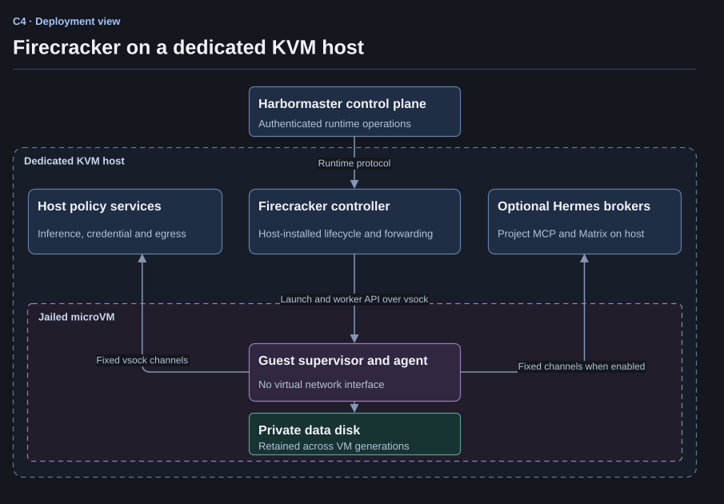

+++
title = "Deployment topology and runtime choices"
+++

Start with the expected data and isolation requirements. The runtime determines how Harbormaster creates workers, enforces network access, and retains project files.

## Kubernetes reference deployment

The controller creates workspaces through Agent Sandbox and forwards requests to ready workers. Kata provides VM-backed execution. NetworkPolicy and infrastructure admission rules constrain access to worker pods. The diagram shows a deployment with project namespace provisioning enabled. Retained worker PVCs use `ReadWriteOncePod`. PostgreSQL and Vault are configured dependencies. Their placement depends on the installation.

Run one control-plane replica. It owns the metadata transitions and scheduler. Size the worker pool and quota separately from platform service resources. Check whether the chosen CNI and storage driver implement the controls before accepting workloads. [Kubernetes setup](../operations/kubernetes.md) · [Cluster dependencies](../operations/cluster-dependencies.md)

## Docker development deployment

Compose runs the dashboard, control plane, MCP, gateways, PostgreSQL, and Vault on a single host. The controller owns the Docker socket. It creates workspace containers, private networks, and persistent volumes. Use this deployment for development and synthetic workloads. See [Docker isolation limits](security.md#important-unverified-boundaries).

## Firecracker host deployment

The host-installed controller launches a jailed microVM per active workspace. The guest has no network interface. Fixed vsock channels carry supported worker and broker operations. A private data disk persists between generations. Verify the host configuration and pinned guest artifacts before starting workloads. [Firecracker topology and acceptance](../firecracker.md)

## Plan for failure and recovery

| Dependency | Effect on work | Recovery concern |
| --- | --- | --- |
| PostgreSQL | Authorization and work-state changes depend on the metadata store. | Back up the database with the credential encryption keys needed for restore. |
| Runtime controller | New lifecycle and forwarded worker requests can fail. | Reconcile runtime state before declaring capacity available. |
| Worker storage | Files and private task history depend on the worker’s retained volume or disk. | Include worker data in the recovery plan alongside platform metadata. |
| Gateway or credential store | Work needing that provider or destination can fail. | Restore policy and credentials, then verify the specific integration. |

See [upgrade and recovery](../operations/_index.md#upgrade-and-recovery) and [acceptance gates for sensitive data](security.md#remaining-release-gates-for-sensitive-data).
