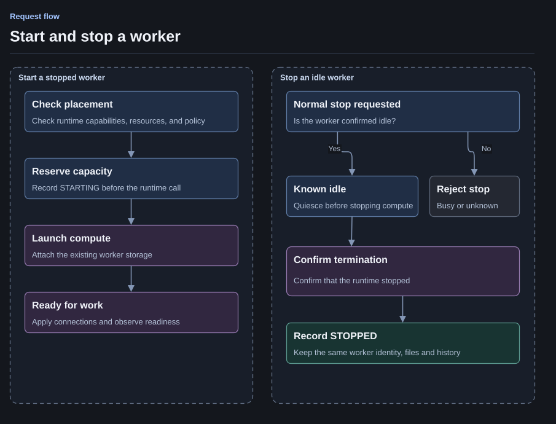
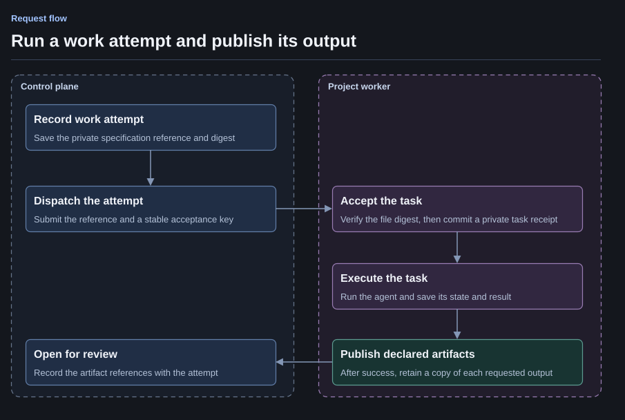
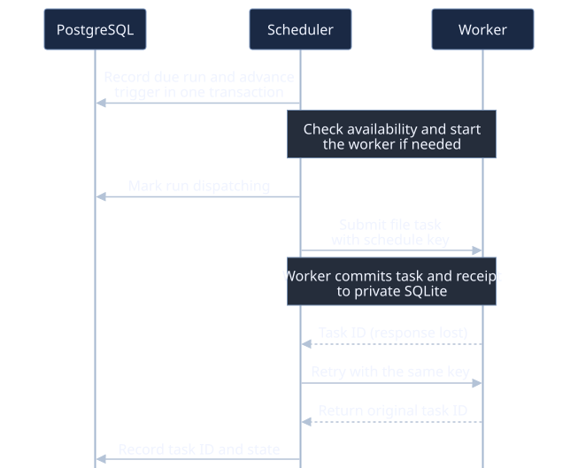

+++
title = "Request flows and recovery"
+++

## Start and stop a worker

The readiness preview is read-only. Start repeats admission and records a quota reservation before contacting the runtime. A normal stop quiesces the worker before stopping its compute. Unknown activity blocks automatic stop. Grant revocation and confirmed termination are separate state transitions.

A task read can wake stopped compute to reach private data without renewing the user's idle deadline. Polling does not count as an explicit open.

## Dispatch and review work

The control plane records a work attempt before submitting its specification reference. The worker checks the digest, records acceptance in private SQLite, and executes the task. After success, it publishes declared artifacts and the control plane records the references for review. [Guest execution and artifacts](guest-execution.md)

## Recover a lost acknowledgement

A scheduling transaction inserts the due occurrence and advances its trigger together. Delivery is at least once. Once the worker accepts a key, a retry resolves the existing task. After worker restart, the worker marks interrupted tasks as failed and retains their acceptance receipts. A fresh run requires a new request. [Schedule management contract](contracts.md#schedule-management)
