+++
title = "Security boundaries and verification"
aliases = ["/docs/security/"]
+++

The default Docker Compose deployment is for local development and synthetic data. Review the [backend support table](_index.md#backend-support) before choosing a runtime.

The optional [Firecracker backend](../firecracker.md) replaces workspace containers
with jailed microVMs that have no network interface. Install it on a dedicated KVM host and run the host acceptance checks before use.

## Trust boundaries

| Crossing | Check |
| --- | --- |
| Browser to dashboard | Local operator authentication or hosted identity. |
| Dashboard or MCP to control plane | Scoped credentials and project authorization on the requested operation. |
| Control plane to runtime controller | Separate controller credential and a bounded set of management operations. |
| Worker to a policy service | Generation-bound grant for the service’s audience, followed by the service policy. |
| Project to project | Approved exchange grants and selected exports. Worker files stay owned by their project. |

The controller is trusted to manage host compute. Workers can run agent-supplied code, so their results and activity are untrusted input. Design for the applicable runtime’s isolation limits and keep the control plane and controller on private network paths. [Deployment topology](deployment-model.md)

## Access and credential controls {#implemented-controls}

- Only the trusted runtime controller receives the Docker socket. It exposes fixed lifecycle operations and a bounded workspace API forwarder, not arbitrary Docker requests, images, mounts, runtime flags or host paths.
- Each workspace receives its own container, internal network and persistent volume; it runs as a non-root user with a read-only root filesystem, dropped capabilities, no new privileges and CPU/memory/PID bounds.
- Workspace grants are derived from a controller-held secret and a container generation. Gateways validate them against currently running, deployment-owned containers. The controller rejects new requests using a stopped container's grant.
- Separate processes handle inference and certificate-backed operations. Provider credentials and certificate keys stay in trusted services. Gateways accept named destinations and operations.
- The inference gateway resolves Codex and Claude subscriptions through a saved worker binding. It enforces provider, model, and destination allowlists. Workers receive generation grants. Active inference streams recheck authorization and stop after revocation. See [subscription credentials](../subscription-agents.md).
- The dashboard read credential grants access to the allowlisted operational snapshot. Hosted project routes use separate signed human claims. The [history cache](../workspace-history.md) contains private recorded content and requires project authorization.
- MCP and the management API require provisioned credentials. Local mode uses one operator identity. Hosted project operations also check project membership.
- The local launcher uses workspace-specific browser origins and scoped, one-use connection tickets. It forwards native T3 HTTP/WebSocket traffic to that workspace, with native credentials held by the workspace supervisor. The local dashboard requires Basic authentication and carries local operator authority.
- Desktop attachment uses a separate `desktop-ws-….localhost` origin with native T3 pairing, token exchange and client authorization. Management-hop credentials never substitute for desktop authority. Foreign web Origins and cross-workspace native tokens are rejected. The loopback launcher may issue a pairing link under its existing operator authority; keep the link private.
- File handoffs authorize both workspaces, accept only bounded project-relative paths, read confined regular files and atomically create a new destination without replacement. Content stays out of platform metadata/logs. Copies are explicit handoffs, not a cross-workspace mount or credential-sharing channel.
- Stop uses a workspace quiesce handshake, atomically refusing new tasks before stopping an idle runtime. Unknown activity blocks automatic stop. Transport disconnect does not cancel accepted tasks.

## Worker egress

These are the mediated paths in the Docker deployment. Dashed arrows show grant verification. Each service checks the grant for its own audience and applies its own policy. Provider credentials and certificate keys stay in trusted services. See [connection profiles](#workspace-connection-profiles) for the separate direct egress path in Fully open mode.

## Docker isolation limits {#important-unverified-boundaries}

Docker internal networks are not a complete host firewall. Host listeners, DNS, IPv6, gateway interfaces and multihomed platform services require adversarial testing and host enforcement. An explicit loopback-only DNS forwarder configuration removes the default public DNS fallback from the workspace execution profile, but its behavior still requires Docker-level verification.

The development controller therefore reports `network_status=unverified`. It does not claim that network segmentation proves allowlist-only containment against a compromised guest.

The Docker controller requires runc when starting a workspace. It rejects legacy Kata containers at startup and rejects a legacy `WORKSPACE_RUNTIME=kata` setting. Kata deployment uses the Kubernetes backend.

Docker refuses workspace startup when `REQUIRE_VERIFIED_ISOLATION=true`. Kubernetes also refuses verified-isolation startup while its runtime reports isolation as unverified. Firecracker checks its mandatory VM controls when starting a worker.

The Docker socket grants root-equivalent host authority to the runtime controller. Host administrators are trusted. Do not expose the controller on the LAN or mount its socket/credential into untrusted components.

## Release gates for sensitive data {#remaining-release-gates-for-sensitive-data}

1. Pin and verify the selected Kubernetes Kata/VMM/storage combination, one VM per workspace, guest-root containment, resource bounds and host backend confinement.
2. Enforce and test host-side deny rules covering forwarding, host INPUT, DNS and IPv6; gateway loss, policy failure and daemon restarts must preserve denial.
3. Verify real hosted identity, project membership, credential scope, and revocation in the target installation.
4. Provision approved provider credentials and broker certificates for the integrations you enable. Review which workspace data may leave through inference and results.
5. Revalidate native T3 browser/HTTP/WebSocket access, disconnect/reconnect, cold starts and provider compatibility under the chosen microVM and host policies. Native browser access and desktop pairing/token exchange/WebSocket calls have functional Docker checks; remote exposure remains a separate gate.

No test involving mocks or ordinary containers establishes these gates. Review [Docker daemon security](https://docs.docker.com/engine/security/) and the [Kata threat model](https://github.com/kata-containers/kata-containers/blob/main/docs/threat-model/threat-model.md) before changing this boundary.

## Workspace connection profiles

Workspace Settings select Blocked, GitHub only, Custom allowlist or Fully open.
GitHub only allows `github.com:443`. Custom rules contain exact
public hostname/IP and TCP port pairs (maximum 64); no wildcard, URL, or guest DNS
fallback. HTTP and HTTPS use the trusted egress proxy, which resolves destinations,
rejects private/loopback/link-local addresses and verifies a generation-bound grant.
HTTP redirects are returned to clients; each subsequent request is checked again.
CONNECT checks the destination. Encrypted paths, methods, and payloads are opaque to the proxy. Private/LAN targets are excluded from custom allowlists.

Fully open is an explicit per-workspace opt-out from destination restrictions. It
adds a separate owned non-internal Docker bridge and normal external DNS; native
tools use direct networking, including TCP/UDP, SSH, Internet and reachable LAN/host
services. Private homes and volumes retain project ownership, but unrestricted networking is not a
network confidentiality boundary between projects or against the host.

The workspace must be stopped before changing into or out of fully open mode. On
start, a stopped container is recreated as needed using the same validated data
volume and home. Runtime configuration reports the actual mode separately from
the desired profile. Applying restricted rules while an open network remains
attached is refused. Fully open intentionally continues direct egress if platform
services fail; proxy modes fail closed when their grant verifier is unavailable.

Fully open is never enabled by default or silently selected.

Workspace supervisors run alongside agent code. Treat their activity, results,
and artifact metadata as untrusted. The control plane checks work-item download
bytes against the SHA-256 digest recorded for the artifact before serving them.
