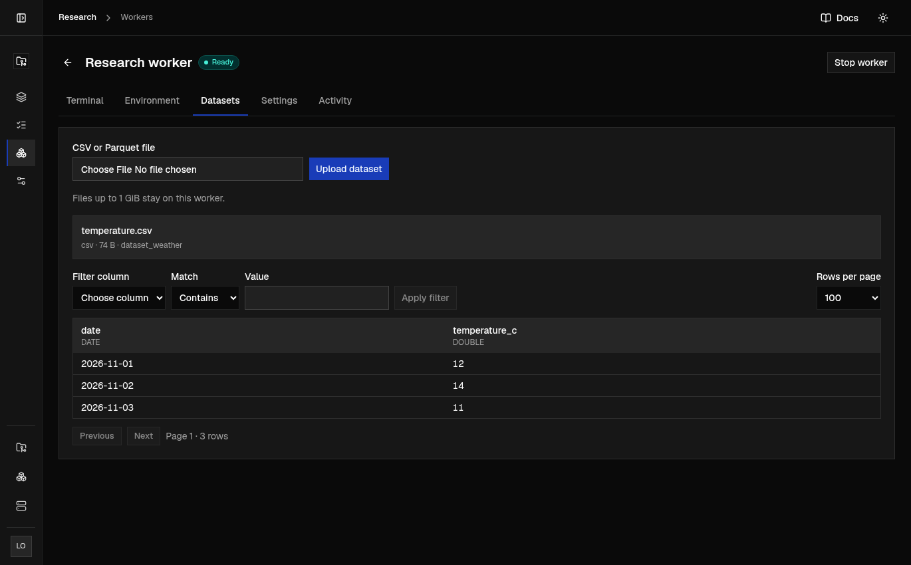

+++
title = "Analyze data on a worker"
+++

Open a project with a running worker to upload a CSV or Parquet file. Use the table preview to check the data before asking an agent to analyze it.

## Upload and explore a dataset

1. Open a running worker and select **Datasets**.
2. Upload a CSV or Parquet file. The worker records its schema, logical ID, and SHA-256.
3. Select the dataset to explore its rows. Use the column headers to sort. Use **Filter column** to filter.
4. Start a work conversation on that worker and select **Research / Data Science** as the work profile. Include the dataset ID in your request. The task opens in **Analysis**. Use **Datasets** to upload, inspect, and preview data for that worker.



Datasets and derived results live alongside the worker's Git checkout. The browser reads bounded previews through the workspace gateway. An agent can use native DuckDB and Python inside the worker to process the source data. Worker deletion can remove datasets, result files, and registered artifacts.

## Ask an agent to analyze the data

If you want to practise with a small file, save these lines as `temperature.csv` and upload it.

```csv
date,temperature_c
2026-11-01,12
2026-11-02,14
2026-11-03,11
```

Open a **Research / Data Science** thread for the same worker. In your message, paste the dataset ID shown in **Datasets**. Ask the agent to chart the temperature by date and explain which day was warmest. Open **Analysis** to inspect the result.

## Explore and delete visualizations

Open **Analysis** in a data science task to browse the charts, maps, and tables the agent has registered on its worker. Results appear automatically, including visualizations the agent created for a report.

Select **New visualization** to describe a new result to the agent. To experiment with an existing result, select it and choose **Ask agent to edit**. The agent registers the revision as a separate visualization. Select the pencil beside the title to edit the title or description for your account.

To remove a result, select **Delete visualization** and confirm. The dataset and derived data stay on the worker. Reports and replies that reference the deleted visualization show it as unavailable.

## Build and export a report

Open **Report** in a data science task. When the agent updates the same report file, Workbench keeps one entry. Use the **Report version** menu to preview or export an earlier captured version.

1. Select **New report** or open an existing report and select **Edit**.
2. Set the title and write your findings. Use the formatting toolbar for headings, lists, links, and other Markdown formatting.
3. Find a table, chart, or map under **Visualizations**, select **Copy Markdown**, and paste the snippet on a blank line where the result should appear. You can paste a result more than once.
4. Select **Save and preview** to save the Markdown to the worker and review the report.
5. Open **Export** and choose **Download PDF**, **Download HTML**, or **Download Markdown**.

Select a visualization name in the editor to open that result in **Analysis**. Results labeled **Used in report** have an **Ask agent to edit in report** action. The agent registers the revision and updates the existing report.

HTML and PDF include up to 25 rows per referenced table and static views of the charts and maps. PDF uses an A4 layout with selectable text and numbered pages. The Markdown keeps figure references in `worker_id/artifact_id` form. Open the Markdown in the project's file viewer to render those references while the originating worker and its data are available.

For command-line analysis and visualization specifications, see the [developer analysis guide](development/analysis.md#analyze-data-in-the-agent-shell).
