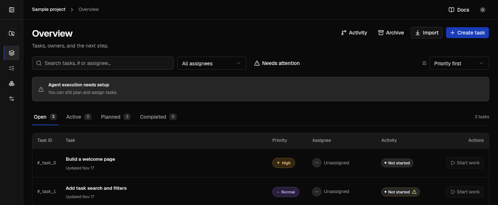

+++
title = "Plan and sync project tasks"
+++

Open your project and select **Overview**. You can plan work here before asking an agent to run it.

## Find a task

| To see | Select |
| --- | --- |
| Tasks you own or reviews assigned to you | **For me** |
| Tasks waiting for attention or blocked by other tasks | **Needs attention** |
| How tasks depend on one another | An activity pill to open **Dependencies**, or **Activity** in the toolbar for the project graph |
| Tasks hidden from the active list | **Archive** |

## Create and dispatch a task

1. Select **Create task**. Enter a title and description, then choose a work profile. Save the task.
2. Open the task to set its priority, assignee, or dependencies.
3. Select **Start work** when the task is ready and your account can control the agent. Open the conversation to follow execution.

A planned task stays idle until dispatched. Editing its description changes project planning metadata. Send instructions in the conversation to change what the worker does on the next run.

## Update task status or archive a task

Before the first run, open the task and change **Planning status**. After a run exists, the task status follows its execution and review. To continue completed work, open its conversation and send a new request.

Use the task's archive action to hide it from the active list. Archiving leaves current execution and the provider issue state alone. Restore the task from the archive when it needs to appear in the active list again.

## Import and sync repository issues

1. Ask the platform operator to [connect the repository](repository-connections.md). In **Overview**, select **Import** and choose the issues.
2. Open an imported task and edit its title, description, or status. The import creates a local task and records its source. Import retries reuse that link.
3. Use **Push changes** to write changes, or **Refresh from repository** to read the current upstream values. The local Done status maps to a closed issue. Other active statuses map to open.

If both sides change since the last sync, the platform keeps your local edits and reports a conflict. Select **Use repository version** only when you want to discard the local title, description, and status changes. Refreshing an approved or closed task preserves its local review outcome.

Remote writes require platform operator authority. Project-scoped clients can use `board_list`, `board_create`, and `board_update` to manage local planning records. Read the latest revision before a `board_update` retry after a conflict.
