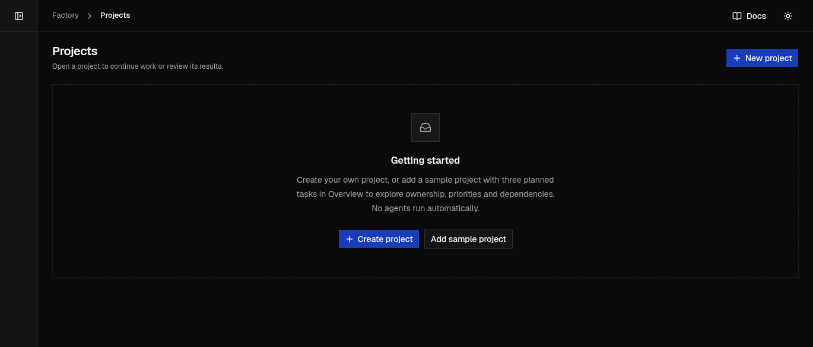
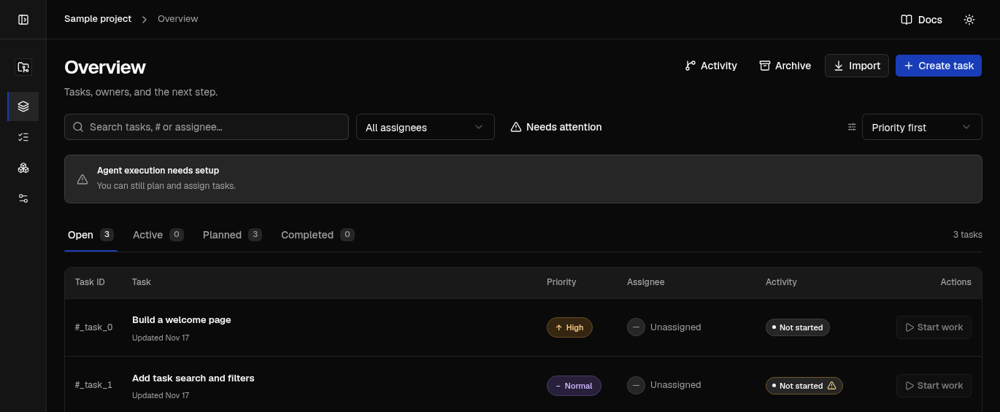
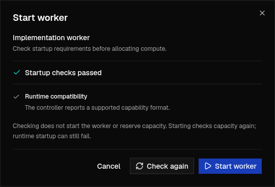

+++
title = "Get started in the dashboard"
description = "Open a project, find its tasks and workers, and start your first agent conversation."
+++

Use the dashboard to give an agent work and check what comes back. Start here if someone has given you a Harbormaster account. If you need to install the platform, use the [deployment guide](deployment.md).

## Open a project

1. Open the dashboard link from your operator or project administrator.
2. Sign in with the account they approved. If you received a project invitation, select **Accept invitation** on **Projects**.
3. Open the project you want to work in. If you have permission, use **New project** to start an empty one. When no projects exist, **Add sample project** lets you explore a task board without starting a worker.

If your project is missing, check that you signed in with the invited email address. Ask your project administrator to confirm your access.

## Find your way around

Everything you do with an agent belongs to a project. The project name in the sidebar tells you which project is open.

| Page | What you can do |
| --- | --- |
| **Overview** | Add tasks to the project plan, check progress, or open an existing task. |
| **Workspace** | Start a thread, give an agent instructions, and review its reply and files. |
| **Workers** | See where agents run. Start or stop a worker and inspect its activity. |
| **Settings** | Change project settings and, if you have permission, manage members. |

A **thread** keeps the messages and revisions for a piece of work. An **agent** executes your instructions. A **worker** is the environment where the agent runs and where its files live. The APIs also call this environment a workspace.

## Plan a task

1. In **Overview**, select **Create task**.
2. Give the task a short title. In the description, say what you want and what you will check before accepting it.
3. Choose a work profile and save the task. Open it to set priority, assignees, or dependencies.
4. Select **Start work** when you are ready to assign the task to an agent. To give an agent work without creating a board task first, open **Workspace** and start a thread. [Run your first agent task](work-conversations.md)

Use the [task board guide](issue-board.md) to import existing repository issues or organise dependent tasks.

## Manage a worker

Use an existing worker when you need its files or its configured agent. Use **Workers**, then **Create worker**, when you need a separate environment and have permission to create one.

1. Open **Workers** and select **Open worker**.
2. If the worker is stopped, select **Check & start**. Read the readiness checks, resolve any reported blocker, then select **Start worker**.
3. When the worker is ready, return to the task in **Workspace**. For interactive work, use [Open T3 or connect the desktop app](interactive-workspaces.md).

To release capacity, finish or cancel active work and stop any running preview apps. Return to the worker and select **Stop worker**. The worker keeps its files and recorded history.

## Change a worker's network access

If the task needs a repository or another external service, ask your project administrator which [connection profile](architecture/security.md#workspace-connection-profiles) to use. In **Workers**, open the worker and select **Settings** to see the applied profile. Some changes require a stop and start.

## Invite someone to your project

If you can manage membership, open **Settings**, then **General**. Under **Project members**, enter the person’s sign-in email, choose **Member** or **Administrator**, and select **Invite member**. Ask them to sign in with that address and select **Accept invitation** in **Projects**.

## Choose your next task

| I want to | Guide |
| --- | --- |
| Send instructions and approve an output | [Run your first agent task](work-conversations.md) |
| Inspect a website or desktop app | [Preview an application](application-previews.md) |
| Review files or send visual feedback | [Review a result](reviews.md) |
| Upload a CSV or build a report | [Analyze data on a worker](data-science-workbench.md) |
| Open T3, copy a file, or branch a worker | [Work with an interactive worker](interactive-workspaces.md) |
| Find an old conversation or export it | [Read private history](workspace-history.md) |
