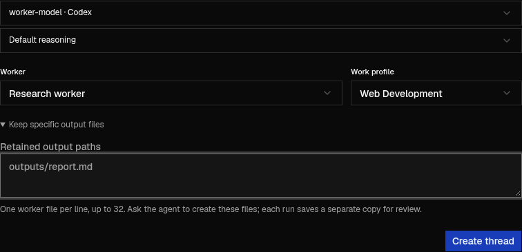
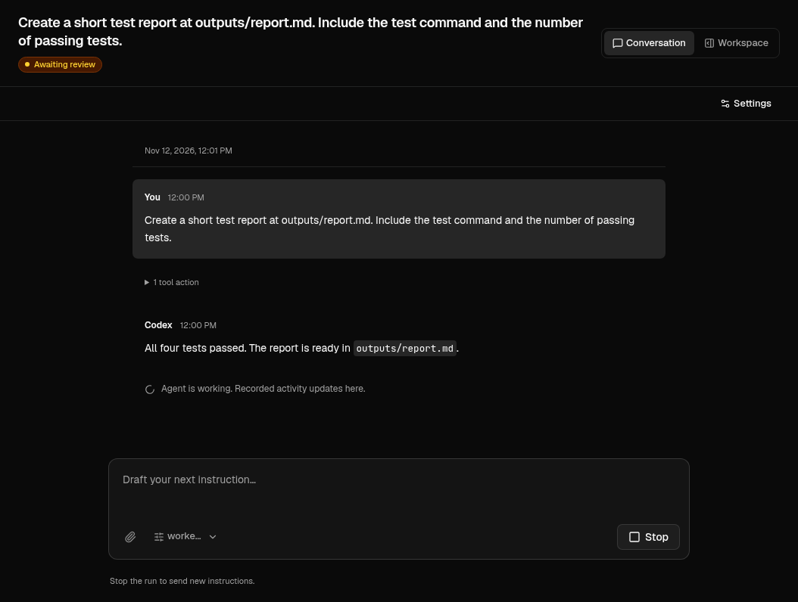
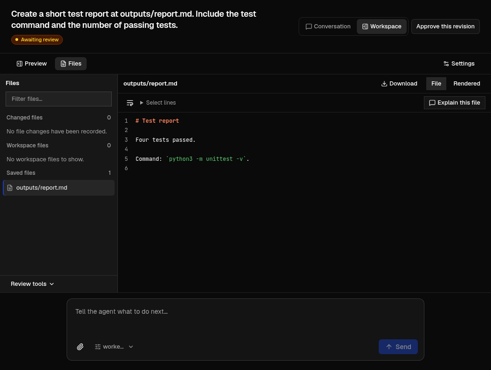

+++
title = "Run your first agent task"
description = "Create a thread, send the agent a small task, inspect the output file, and approve the result."
+++

In this walkthrough, you ask an agent to run a small Python test and write a report. You will inspect the report and decide whether to approve it.

You need access to a project and a worker with a real model configured. Check with your operator if you only have a default local Compose installation. Its synthetic mode can verify the platform with a [CLI smoke test](getting-started.md).

## Create a thread

1. Open your project and select **Workspace** in the project sidebar.
2. Select **New thread**. Choose **Web Development** for this exercise.
3. Select a worker and model. If your installation supports automatic provisioning, you can choose **Automatic worker** and confirm the default model.
4. Expand **Keep specific output files** and enter `outputs/report.md`. Harbormaster can keep a copy of that file with this revision.
5. Select **Create thread**. The new thread opens with an empty message box.



## Send the task

Paste this message in the thread and select **Send**.

```text
Create a short test report at outputs/report.md. Include the test
command and the number of passing tests. First, write a Python function
that adds two numbers and run four tests using the standard library.
```

The thread displays progress as Harbormaster records it. Expand a tool action to see the command or result. You can switch pages while it runs. To request cancellation, open the thread and select **Stop task**.



## Inspect and approve the report

1. When the agent replies, select **Workspace** at the top of the thread. This opens the tools for the current thread.
2. Select **Files**, then open **outputs/report.md**. Check that it names the command and reports the number of passing tests. Compare it with the tool activity in **Conversation**.
3. If you want changes, send a follow-up message in the same thread. For example, ask for a test with negative numbers. The agent starts another run and can use files on the same worker.
4. When the output meets the request, select **Approve this revision**. The task moves to **Done**.



## If you get stuck

| What you see | What to do |
| --- | --- |
| The model list is empty | Select a different configured worker or ask your operator which model is available. If your team uses personal subscriptions, [load your subscription on the worker](subscription-agents.md). |
| The worker cannot start | Open it in **Workers**, select **Check & start**, and read the failed check. |
| The run failed | Read the error in the thread. Select **Retry task** for a temporary failure or send corrected instructions. |
| The report is missing | Check the output path and ask the agent to write `outputs/report.md`. |
| A stopped thread prompts you to load its history | Select **Load conversation** if you need messages that are not already available. |

For a web or desktop project, [open an application preview](application-previews.md) to review the running app. For a planned task, see [how to track work on the project board](issue-board.md).
